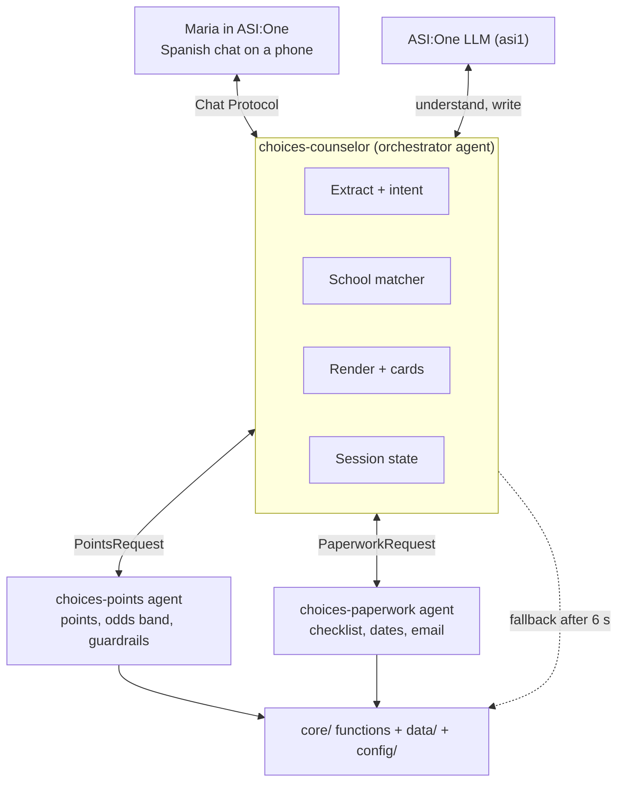
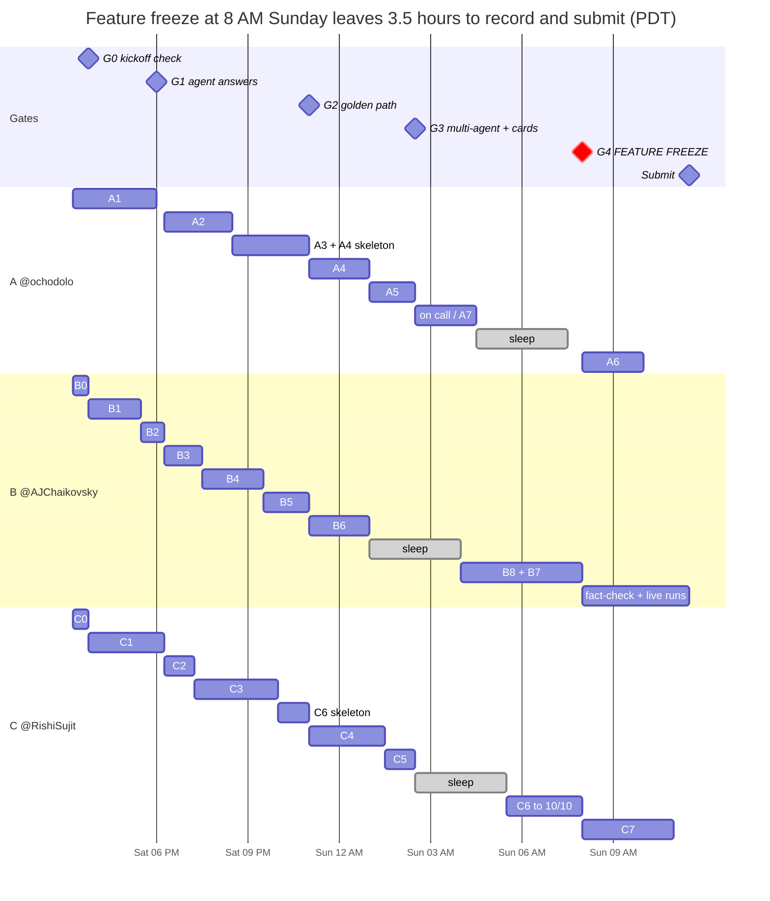

# Choices Counselor — LA Hacks Build Plan

Oct 17, 2026 · Rishi Sujit · Live, commentable version: https://claude.ai/code/artifact/45849190-1a97-4521-8f47-f23685c7e904

## Winning strategy

We win Fetch.ai's ASI:One Agent Challenge with one scripted, 3-minute ASI:One conversation that never breaks. Every one of the five judging criteria gets a moment the judges can see on screen. Breadth loses; a flawless, emotionally clear demo grounded in verified LAUSD rules wins.

**Our edge over other teams:** a real deadline 19 days after judging (Nov 6), a real parent persona, Spanish-first UX, and guardrails that catch mistakes that cost families their magnet points. Most hackathon agents are wrappers around a chat model. Ours does deterministic math and rule checks, split across several agents.

| Criterion | Weight | What the judge must see | Feature that delivers it |
| --- | --- | --- | --- |
| Functionality | 25% | 4-turn Spanish conversation completes in ASI:One with no errors | Golden path, seeded data, fallbacks on every LLM call |
| Use of Fetch tech | 20% | 3 registered agents, Chat Protocol, visible handoffs, Interactive Cards | Orchestrator + Points agent + Paperwork agent on Agentverse; school carousel and packet review cards |
| Innovation | 20% | Agent catches a costly mistake the parent was about to make | Guardrail turn: 4th school blocked, points-forfeit warning, rank-order advice |
| Real-world impact | 20% | Real deadline, real rules, cited sources, equity framing | Verified points config, Nov 6 countdown, Choices office hotline, privacy line |
| UX / presentation | 15% | Phone-friendly cards, plain Spanish, ready-to-send email | Carousel, review card, drafted coordinator email |

**Rules we hold to all weekend:**

- Math and rule checks are code; understanding and writing are the LLM.
- If a fact is not verified, the agent does not say it. Null beats a guess.
- The golden path is the only path that must work 10 times out of 10. Everything else degrades gracefully.
- Feature freeze Sunday 8:00 AM. After that, only bug fixes, video and submission.

## Verified facts

Everything below comes from the official 2027-28 Choices brochure, the Choices site's guidelines and FAQ, and LAist, all read on Oct 17, 2026. These go straight into `config/` and the guardrails. Three facts in the original brief were wrong and are corrected here.

**Corrections to the original brief**

- **Limit is 3 magnet choices, not 3 programs total.** A family can apply to up to 6 program *types* (Magnet, Dual Language/MMP, SAS, Early/Middle College, PWT, Affiliated Charter) and up to 3 choices within Magnet. EMC allows only 1.
- **"LAUSD may place your child at any listed school" is not an official rule.** The real risks are: (a) if not selected, the child is waitlisted for the **1st choice only**; (b) no response counts as a decline and **all declines are final**; (c) declining a magnet offer **wipes all waiting-list points**.
- **Points apply to magnets only.** Dual Language, Affiliated Charter, and EMC use lotteries and sibling/resident priorities, with no points.

### Magnet Priority Points (on-time applications only)

| Factor | Points | Rule that matters for the agent |
| --- | --- | --- |
| Matriculation | 12 | Finishing the top grade of a magnet and applying to the next level. One year only. Never combined with waiting-list points |
| Waiting list | 4 per year, max 12 | Prior 3 consecutive years on a valid on-time waitlist. Declining a magnet offer removes **all** of them. Applying for the same grade twice earns none |
| PHBAO resident school | 4 | Based on the 2027-28 resident LAUSD school. Recomputed every year, not cumulative |
| Overcrowded resident school | 4 | Based on the 2026-27 resident school. Recomputed every year |
| Sibling | 3 | Sibling continuing at the **1st-choice** school, same address, same Apply account |
| Late or invalid application | 0 | Late, out-of-district, or wrong-grade applications earn no points |

Max is 23 because matriculation and waiting-list points are never combined. Selection also balances racial enrollment and depends on available space. That is why the agent must never present an exact probability.

### Process rules the guardrails enforce

- Up to 3 magnet choices; 2nd and 3rd are optional. Not selected for the 1st → considered for the 2nd and 3rd. Selected for any → off the other waitlists.
- A student already in a magnet who is selected into another magnet loses the current seat, **whether they accept or decline**.
- Students with disabilities and English Learners are explicitly eligible. Only Gifted and Highly Gifted magnets need eligibility verification.
- Applications are online only at apply.lausd.net (a Parent Portal account). A smartphone works. Families can also use parent centers, libraries, or Region Welcome Centers.
- Only the first application submitted for a child counts. Online edits are allowed until Nov 6. Corrections or withdrawal by email until Dec 18.
- Magnet bus: may be provided for grades 6-12 if the family lives more than 2 miles from the school. Max ride is 90 minutes. No new stops are added for 2027-28. Transportation: 1-800-LABUSES.
- DLE: English Learners whose home language is the program's target language can enroll at any grade with no language test. **This helps Diego.**

### Key dates

| Date | Event |
| --- | --- |
| Oct 1, 2026 | On-time window opened |
| Nov 6, 2026 | **On-time deadline; last day for online edits** |
| Dec 1, 2026 | Late window opens (no points, end of the waitlist) |
| December 2026 | Confirmation notice: check the points and sibling info |
| Dec 18, 2026 | Last day to correct or withdraw (email ApplyforSchools@lausd.net) |
| Early Feb 2027 | Selection / waiting-list notification |
| Mar 5, 2027 | Accept or decline. No response = decline |
| Aug 12, 2027 | School year starts |

### Real programs near Boyle Heights (seed data candidates)

The official brochure has **no visual and performing arts (VAPA) magnet for middle school in the East region**. The closest arts-oriented options are STEAM and New Media programs. The agent says this honestly, and it makes a good "the agent knows the system" moment in the demo.

| Code | Program | Theme | Address | Fit for Diego |
| --- | --- | --- | --- | --- |
| 1804703 | Bel Vedere MS | STEAM (includes Arts) | 312 N Record Ave, 90063 | Best arts fit nearby |
| 1804702 | Bel Vedere MS | New Media: Media/Communications | 312 N Record Ave, 90063 | Arts-adjacent |
| 1817902 | Hollenbeck MS | STEM/Medicine | 2510 E 6th St, 90023 (Boyle Heights) | Closest to home |
| 1817903 | Hollenbeck MS | Law/Public Service | 2510 E 6th St, 90023 | Closest to home |
| 1838702 | Stevenson College & Career Prep | Gifted (needs verification) | 725 S Indiana St, 90023 | Use to show the eligibility warning |
| 1838701TWS | Stevenson MS | Spanish Two-Way DLE | 725 S Indiana St, 90023 | Spanish home language; no points |
| 1816801 | Griffith MS | STEM + Spanish DLE | 4765 E 4th St, 90022 | Second-tier option |
| 1820002 | Los Angeles Academy MS | STEAM | 644 E 56th St, 90011 | Arts in STEAM |
| 1800903 | Adams MS | Robotics/Engineering | 151 W 30th St, 90007 | Near Maria's downtown job |
| 1823703 | Markham MS | VAPA | 1650 E 104th St, 90002 | Only nearby-ish true VAPA; long commute, so show the trade-off |

Each official magnet page (`choices.lausd.net/Magnet/MagnetSchoolDetail?sc=<code>`) shows **Program Capacity 2026-27, Applications Received 2025-26, and Openings 2026-27**. The pages load only in a live browser session. Dev B collects these numbers by hand for the 10 seed programs. They give us a real, cited competitiveness ratio (applications ÷ openings), so we never need to invent odds.

### Fetch.ai technical facts

- Pin `uagents==0.25.5`. The chat protocol must report `AgentChatProtocol 0.3.0`. Use `mailbox=True`, `publish_agent_details=True`, and `agent.include(chat_proto, publish_manifest=True)`.
- Agent-to-agent calls: shared `Model` classes and `await ctx.send_and_receive(addr, msg, response_type=X)`, which returns a `(reply, status)` tuple. Always check `isinstance`.
- Interactive Cards: `MetadataContent` with `card_protocol_version: "1"`, `requires_card_interaction`, `card_kind` (carousel, detail, form, review, custom), and `card_payload` as a JSON **string** of at most 64 KB. An invalid card silently falls back to text. A card click comes back as prose (planner-routed) or JSON (direct @mention).
- Payment Protocol: `RequestPayment → CommitPayment / RejectPayment → CompletePayment` from `uagents_core.contrib.protocols.payment`. Stretch only.

Sources: [Choices brochure 2027-28](https://choices.lausd.net/Brochure/Brochure_EN.pdf?27) · [Choices general guidelines](https://choices.lausd.net/Home/GeneralInformation) · [Choices FAQ](https://choices.lausd.net/Home/faq) · [LAist timeline](https://laist.com/news/education/lausd-choices-application-2027-2028-school-year-magnets-charters-dual-language) · [LAist points explainer](https://laist.com/news/education/lausd-magnet-points-choices-application-los-angeles-unified-es-navegar) · [Fetch ASI-compatible agents](https://innovationlab.fetch.ai/resources/docs/examples/chat-protocol/asi-compatible-uagents) · [Fetch agent-to-agent](https://innovationlab.fetch.ai/resources/docs/agent-communication/uagent-uagent-communication) · [Fetch Interactive Cards](https://innovationlab.fetch.ai/resources/docs/interactive-cards/asi-interactive-cards) · [Fetch Payment Protocol](https://innovationlab.fetch.ai/resources/docs/agent-transaction/agent-payment-protocol)

## Architecture and shared contracts

Three uAgents run on Agentverse. The orchestrator owns the conversation, and two specialists own the deterministic work. Every specialist call has a **local fallback**: if a remote agent doesn't reply within 6 s, the orchestrator calls the same `core/` function in-process and logs it. The demo can't die on a network hop.



The dashed path is what keeps the demo alive: the orchestrator can always compute the same answer in-process.

### Agents

| Agent | Owns | LLM? | Talks to |
| --- | --- | --- | --- |
| `choices-counselor` (orchestrator) | Chat Protocol, session state, intent routing, profile extraction, school matching, reply rendering, cards | Yes, asi1: extraction + reasons + polish | ASI:One, both specialists |
| `choices-points` | Magnet points, competitiveness band, list guardrails | No | Orchestrator only |
| `choices-paperwork` | Checklist, deadlines with days left, phone steps, coordinator email | Email draft only, with a template fallback | Orchestrator only |

Matching stays inside the orchestrator because it is fast and needs no extra hop. Points and paperwork are separate agents because they are self-contained services other agents could pay to call, which supports the monetization story.

### Repo layout

```
agents/
  orchestrator.py      # Dev A
  points_agent.py      # Dev A (wraps core/points + core/guardrails)
  paperwork_agent.py   # Dev A (wraps core/paperwork)
  messages.py          # Dev A: shared uagents Models, frozen at H+1
  cards.py             # Dev C: Interactive Card builders
core/
  types.py             # FROZEN at H+1 (all devs agree)
  matcher.py           # Dev B
  points.py            # Dev B
  guardrails.py        # Dev B
  paperwork.py         # Dev B (checklist/steps/deadlines) + Dev C (email)
  extract.py           # Dev C: free text -> FamilyProfile
  intent.py            # Dev C: which turn is this?
  render.py            # Dev C: es/en templates
  llm.py               # Dev C: asi1 client, timeout, retry, fallback
data/schools.json      # Dev B
config/points.json  config/deadlines.json  config/limits.json   # Dev B
i18n/es.json  i18n/en.json                                     # Dev C
tests/                 # each dev owns their module's tests; Dev C owns tests/golden/
scripts/replay_golden.py   # runs Maria's 4 turns without ASI:One
```

### Core types (`core/types.py`, Pydantic, frozen at H+1)

```python
class FamilyProfile(BaseModel):
    language: Literal["es", "en"] = "en"
    child_name: str | None = None
    current_grade: int | None = None          # 5
    applying_grade: int | None = None         # 6 (derived: current + 1)
    interests: list[str] = []                 # normalized tags: arts, stem, medicine, law, media, languages, sports
    iep: bool | None = None
    iep_notes: str | None = None
    english_learner: bool | None = None
    home_language: str | None = None          # "Spanish"
    home_neighborhood: str | None = None      # "Boyle Heights"
    resident_school: str | None = None
    resident_phbao: bool | None = None        # None = unknown -> ask or caveat
    resident_overcrowded: bool | None = None
    in_magnet_now: bool = False
    waitlist_years: int = 0
    sibling_program_codes: list[str] = []
    parent_work_area: str | None = None       # "Downtown"
    device: str = "phone"
    intended_choices: list[str] = []          # program codes in rank order
    would_not_accept: list[str] = []

class SchoolMatch(BaseModel):
    code: str; name: str; program_type: str; theme: str
    score: float
    reason_codes: list[str]                   # e.g. ["arts_in_steam", "near_home", "spanish_dle"]; render.py localizes
    distance_km: float | None

class PointsLine(BaseModel):
    factor: str; points: int; status: Literal["confirmed", "assumed", "unknown"]

class PointsEstimate(BaseModel):
    code: str
    applicable: bool                          # False for DLE / charter / EMC
    total: int; max_possible: int = 23
    lines: list[PointsLine]
    competitiveness: Literal["very_high", "high", "moderate", "unknown"]
    apps_per_opening: float | None            # from official page, else None

class Warning(BaseModel):
    code: str                                 # "over_limit", "would_not_accept", "gifted_verification", ...
    severity: Literal["block", "warn", "info"]
    params: dict = {}

class ActionPlan(BaseModel):
    checklist: list[str]; deadlines: list[dict]; steps: list[str]
    email_subject: str; email_body: str; warnings: list[Warning]
```

Reasons and warnings travel as **codes**, not sentences. `render.py` turns them into Spanish or English. That keeps the core logic testable and stops the LLM from inventing facts.

### Agent messages (`agents/messages.py`)

```python
class PointsRequest(Model):   session_id: str; profile_json: str; codes: list[str]
class PointsResponse(Model):  session_id: str; estimates_json: str; warnings_json: str
class PaperworkRequest(Model): session_id: str; profile_json: str; codes: list[str]; language: str
class PaperworkResponse(Model): session_id: str; plan_json: str
```

JSON strings keep the Models trivial and avoid nested-model serialization bugs between agents.

### Conversation state

The orchestrator keeps `ctx.storage[f"session:{sender}"]` with `{profile, matches, estimates, plan, stage}`. Stages are `intake → matched → odds → listing → plan`. Each turn: acknowledge, then `intent.classify(text, stage)` (keyword rules in es/en first, LLM fallback second), merge any new facts into the profile, call the tools, render, reply.

### Handoff log (shown in the demo)

Every hop prints one line, and the reply ends with a one-line footer in the parent's language:

```
[HANDOFF] counselor -> choices-points agent1q…x7 PointsRequest session=ab12 codes=3  (412 ms)
[HANDOFF] choices-points -> counselor PointsResponse total=4 warnings=2
```

Footer: *"Consulté: Agente de Puntos · Agente de Trámites"*. Judges see the multi-agent orchestration inside ASI:One itself, not only in a terminal.

### Environment (`.env.example`)

`ASI1_API_KEY`, `COUNSELOR_SEED`, `POINTS_SEED`, `PAPERWORK_SEED`, `POINTS_AGENT_ADDRESS`, `PAPERWORK_AGENT_ADDRESS`, `REMOTE_TIMEOUT_S=6`, `USE_REMOTE_AGENTS=true`, `LLM_TIMEOUT_S=12`, `DEMO_MODE=true` (seeds the Boyle Heights resident school and pins temperature 0).

## Team roles and branch strategy

**Final ownership (Sat 3:15 PM).** The GitHub issues are the source of truth for owners, times, and test checkpoints. Each pinned queue issue (#26, #27, #28) lists one person's tickets in order.

| Dev | GitHub | Role | Owns | Queue |
| --- | --- | --- | --- | --- |
| A | @ochodolo | Agents and Fetch platform | `agents/*.py` except cards, Agentverse accounts and registration, mailbox, hosting, handoff logs, fallback, README, submission registration | #26 |
| B | @AJChaikovsky | Core logic and data | `core/matcher.py`, `points.py`, `guardrails.py`, `paperwork.py`, `data/`, `config/`, fact verification, seat numbers | #27 |
| C | @RishiSujit | Language, UX, demo | ASI:One API key, `core/llm.py`, `extract.py`, `intent.py`, `render.py`, `email_draft.py`, `agents/cards.py`, `i18n/`, golden tests, video, Devpost | #28 |

**Who presents:** Dev C drives the demo, Dev A narrates the architecture slide, and Dev B answers questions about the rules. Rehearse that split at least 3 times.

### Branch rules

- `main` is always runnable: `pytest` passes.
- One branch per ticket, named as in the ticket (for example `b/B3-matcher`). When the ticket's test checkpoint passes, merge your own branch into `main` with `Closes #N` in the merge commit message. No PR review is required.
- Contract changes to `core/types.py`, `agents/messages.py`, or the signatures in `core/stubs.py` need all three devs to agree in chat. Add fields or codes freely; never rename or remove one.
- Commit messages are `<card-id>: <what>`, for example `B3: sibling points only on 1st choice`. The commit history is the judges' proof that the work was done during the event.
- Secrets only in `.env`, which is gitignored.
- Merge order in each merge window: B (data and logic) → C (language) → A (wiring). Then everyone pulls `main` and runs `pytest` (and, from Phase 3, `python scripts/replay_golden.py`).

## Timeline

About 20.5 hours remain, from 3:15 PM Saturday to the 12:00 PM Sunday deadline. The plan front-loads a reachable agent (G1 at 6:00 PM) and a working golden path (G2 at 11:00 PM), and freezes features at 8:00 AM. Gates are checked out loud by all three devs.



Each gate has one pass condition:

| Gate | Time | Passes when |
| --- | --- | --- |
| G0 | Sat 3:45 PM | Contracts merged (#1, done); everyone runs `pytest` green on `main`; Rishi's live ASI:One call works |
| G1 | Sat 6:00 PM | The stub agent answers in ASI:One from a teammate's laptop |
| G2 | Sat 11:00 PM | Maria's 4 turns work in ASI:One with all logic in one process |
| G3 | Sun 2:30 AM | Both specialists are live on the always-on host, handoffs are logged, the fallback is proven, and the carousel renders |
| G4 | Sun 8:00 AM | **Feature freeze.** Golden passes 10 of 10 locally and live. Only bug fixes after this |
| Submit | Sun 11:30 AM | Devpost, both videos, README, and the Fetch registration are all done; `v1.0-submission` is tagged |

**If a gate slips:**

- G1 late → Dev C pairs with Dev A until it passes. Nothing matters more.
- G2 past 11:30 PM → cut the C4 detail and review cards (keep the carousel) and A4's chat protocol on the specialists.
- G3 past 3:30 AM → ship only the Points agent as a separate agent; Paperwork stays in-process. Drop all stretch cards.
- G4 cannot slip. Whatever passes 10 of 10 at 8:00 AM is the demo.

## Phases (parallel work)

Every phase has one lane per person, and every ticket depends only on the merged contracts and fixtures, or on the same person's earlier tickets. Nobody waits on a teammate's module: A wires against `core/stubs.py`, and C renders and builds cards against `tests/fixtures/`. B's real code replaces both as it merges. Each ticket carries a `phase-N` label and a **Test checkpoint** in its header.

| Phase | Window | A · @ochodolo | B · @AJChaikovsky | C · @RishiSujit | Team test at the end | Exit |
| --- | --- | --- | --- | --- | --- | --- |
| 0 · Kickoff check | Sat 3:15–3:45 PM | Clone, venv, `pytest`, Agentverse + ASI:One accounts; start #2 | #9 B0 review contracts + fixtures | #18 C0 API key + LLM client | Everyone green on `main`; one live ASI:One call | G0 |
| 1 · Foundations | Sat 3:45–6:15 PM | #2 A1 hello ASI:One + mailbox + profile | #10 B1 schools.json → #11 B2 config | #19 C1 extraction | **6:00 PM:** message the stub agent from ASI:One on another laptop | G1 |
| 2 · Core modules | Sat 6:15–8:30 PM | #3 A2 sessions + routing | #12 B3 matcher → #13 B4 points | #20 C2 intent → #21 C3 renderer | Own unit tests before every push; 8:30 PM everyone pulls, `pytest` green | — |
| 3 · Integration | Sat 8:30–11:00 PM | #4 A3 wire golden + #5 A4 skeleton on stubs | #13 B4 finish → #14 B5 guardrails | #21 C3 finish → #24 C6 golden skeleton | **10:30 PM merge window** (B → C → A), `replay_golden.py` with real modules; **11:00 PM** first live 4-turn run | G2 |
| 4 · Multi-agent + UX | Sat 11:00 PM → Sun 2:30 AM | #5 A4 finish → #6 A5 hosting | #15 B6 paperwork (+ #16 B7 in gaps), sleep 1:00 AM | #22 C4 cards → #23 C5 email | **2:30 AM:** `[HANDOFF]` to both specialists, kill-test → `[FALLBACK]`, carousel in ASI:One | G3 |
| 5 · Hardening | Sun 2:30–8:00 AM | On call + #8 A7 (stretch) until 4:30, sleep 4:30–7:30 | Up 4:00 AM: #17 B8 + #16 B7 leftovers | Sleep 2:30–5:30, then #24 C6 to 10/10 | Hourly `ping.py`; **7:30 AM:** `replay_golden.py --runs 10` local AND live = 10/10 | G4 freeze |
| 6 · Ship | Sun 8:00–11:30 AM | #7 A6 README + registration | Fact-check, live golden every 20 min, judge Q&A | #25 C7 video + Devpost | Fresh-clone install; final live run 11:00 AM | Submit |

**What makes this blocking-free:**

1. **The contracts and fixtures are already on `main` (#1).** Reason, warning, checklist, step and deadline codes are frozen, and `core/stubs.py` returns the Maria fixtures, so every lane can start now.
2. **One owner per file.** The email lives in `core/email_draft.py` (C), and `core/paperwork.py` stays B's. `scripts/replay_golden.py` belongs to C6, and A3 reuses it.
3. **A never idles while waiting for merges.** In Phase 3, A wires each module the moment it lands and builds the A4 specialist agents on stubs in between.
4. **Two fixed merge windows, B → C → A:** 8:30 PM and 10:30 PM. Outside them, merge whenever your test checkpoint passes.
5. **Sleep is staggered** (B 1:00–4:00, C 2:30–5:30, A 4:30–7:30), so someone is always awake to watch the host.

## Feature cards: Dev A (agents and Fetch platform)

> Times, owners, dependencies and test checkpoints on the GitHub issues supersede the times written in the cards below.

Dev A's job is to make sure that from 5:30 PM Saturday on, there is **always** an agent in ASI:One that answers. Every later card makes it smarter without ever making it unreachable.

### A0 · Repo scaffold and contracts

Branch `a/A0-scaffold` · Sat 2:30–3:30 PM · Depends on nothing · Pairs with B0 and C0

- [ ] Public GitHub repo; `.gitignore` (with `.env`, `__pycache__`, `.venv`) in the first commit
- [ ] `requirements.txt` pinned: `uagents==0.25.5`, `openai`, `python-dotenv`, `pydantic`, `pytest`, `pyyaml`
- [ ] Folder layout from the Architecture section, with empty modules and docstrings
- [ ] `core/types.py` and `agents/messages.py` written together on one screen in 20 minutes, then frozen
- [ ] `core/stubs.py`: every core function returns canned Maria data, so A can wire the agent before B and C finish
- [ ] `.env.example`, `pytest.ini`, and a one-paragraph `CONTRIBUTING.md` with the branch rules

**Done when:** all three devs clone, run `pip install -r requirements.txt && pytest -q`, and get green.

### A1 · Hello ASI:One

Branch `a/A1-hello-asi` · Sat 3:30–5:30 PM · Depends on A0

- [ ] `agents/orchestrator.py` with `Protocol(spec=chat_protocol_spec)`, `mailbox=True`, `publish_agent_details=True`, `include(..., publish_manifest=True)`
- [ ] Always send `ChatAcknowledgement` first; handle `StartSessionContent`, `TextContent`, `EndSessionContent`
- [ ] Reply with the stub profile summary in the sender's language
- [ ] Connect the mailbox in Agent Inspector; confirm the startup log shows `Manifest published successfully: AgentChatProtocol`
- [ ] Agentverse profile: name `choices-counselor`, description in English and Spanish, keywords (LAUSD, school choice, magnet, IEP, Spanish, Los Angeles), avatar, README with the badges
- [ ] Find the agent through ASI:One search and through a direct @mention; screenshot both into `docs/evidence/`

**Done when:** a teammate on a different laptop messages the agent from ASI:One and gets the stub reply. **Gate G1.**

### A2 · Sessions, routing, and failure handling

Branch `a/A2-sessions` · Sat 5:30–7:30 PM · Depends on A1

- [ ] Session state in `ctx.storage` keyed by sender; stages `intake → matched → odds → listing → plan`
- [ ] Dispatch table: `intent → handler`. Each handler is a pure function `(state, text) -> (state, reply_parts)`, so it is testable without uAgents
- [ ] Reset phrases: "empezar de nuevo", "start over", "reset"
- [ ] A global `try/except` around every handler: log the traceback and reply with a friendly message in the profile's language that includes the Choices hotline (213) 241-4177. **Never** leave ASI:One with a silent agent
- [ ] Messages over about 3,500 characters are split into two `ChatMessage`s

**Done when:** `tests/test_orchestrator_handlers.py` drives all 4 golden turns through the handlers, using stubs, without network access.

### A3 · Golden path wired in-process

Branch `a/A3-wire-golden` · Sat 7:30–10:30 PM · Depends on B3, B4, B5, C1, C2, C3 (stubs until each merges)

- [ ] Replace each stub with the real `core/` function as its PR merges
- [ ] Turn 1 → extract → match → render (cards later). Turn 2 → points. Turn 3 → guardrails. Turn 4 → paperwork
- [ ] Timing log per turn; target under 8 s per reply in ASI:One
- [ ] `scripts/replay_golden.py` runs the same handlers locally and prints the replies

**Done when:** Maria's 4 turns work end to end inside ASI:One with all logic in one process. **Gate G2.** If this slips past 11 PM, cut A4 and C4 to their minimums.

### A4 · Points and Paperwork as separate agents

Branch `a/A4-specialists` · Sat 10:30 PM → Sun 1:00 AM · Depends on A3

- [ ] `agents/points_agent.py` and `agents/paperwork_agent.py`, each with its own seed and mailbox, registered on Agentverse with its own README
- [ ] Each handles `PointsRequest` / `PaperworkRequest` and replies with the response model
- [ ] Orchestrator: `send_and_receive(addr, req, response_type=..., timeout=REMOTE_TIMEOUT_S)`. On timeout or a wrong type, call `core/` locally and log `[FALLBACK]`
- [ ] `[HANDOFF]` log lines plus the "Consulté: ..." footer in replies
- [ ] Stretch: give each specialist the chat protocol too, so a parent can ask `choices-points` directly

**Done when:** a golden run shows `[HANDOFF]` lines to both specialists, and killing `points_agent` mid-demo still produces a correct answer with a `[FALLBACK]` line. **Gate G3.**

### A5 · Always-on hosting

Branch `a/A5-deploy` · Sun 1:00–2:30 AM · Depends on A4

- [ ] All three agents run on a machine that doesn't sleep: a cloud VM the team already has, or a spare laptop on wired Ethernet. Run them in `tmux`, with `scripts/run_all.sh`
- [ ] Use separate seeds from local development, so dev copies can't steal the mailbox
- [ ] Health check: a `scripts/ping.py` that sends a ChatMessage and asserts a reply within 15 s
- [ ] Write down the exact restart command in the README

**Done when:** you close your laptop, and the agent still answers in ASI:One from a phone.

### A6 · README, registration, submission

Branch `a/A6-readme` · Sun 7:30–10:00 AM · Depends on A5

- [ ] README: problem in 3 lines, the two badges, agent names and **addresses**, architecture diagram, setup and run instructions, `pytest` and `replay_golden.py` commands, data sources, "built during LA Hacks 2026" list, limitations
- [ ] Register through the LA Hacks ASI:One submission agent
- [ ] Check that the repo is public, has no secrets (`git log -p | grep -i key`), and that a fresh-clone install works

**Done when:** a teammate follows the README on a clean clone and gets green tests.

### A7 · Stretch: Payment Protocol

Branch `a/A7-payments` · Only if G3 passes before 1:00 AM

- [ ] `choices-points` advertises a paid "bulk report" for partner agents, such as a nonprofit's caseload agent. Uses `RequestPayment` in FET on testnet. Parents always use it free
- [ ] One recorded handshake for the video. Never in the live demo path

## Feature cards: Dev B (core logic and data)

Dev B owns every number the agent says. The rule is simple: each value in `data/` and `config/` carries a `source_url` and a `verified` flag, and anything unverified is `null`. All of B's code is pure Python with no network calls, so it is fully unit-testable.

### B0 · Contracts

Sat 2:30–3:30 PM · With A0 and C0

- [ ] Co-write `core/types.py`. Bring the points table and the guardrail list from the Verified facts section

### B1 · Seed data: `data/schools.json`

Branch `b/B1-schools-data` · Sat 3:30–6:00 PM · Depends on B0

- [ ] The 10 programs from the seed table, with fields: `code`, `name`, `program_type` (magnet/dle/charter), `theme`, `sub_theme`, `grades`, `address`, `zip`, `lat`, `lng`, `region`, `phone`, `website`, `choices_url`, `gifted_verification`, `languages`, `transport_note`, `capacity_2026_27`, `applications_2025_26`, `openings_2026_27`, `verified`, `source_url`
- [ ] `lat`/`lng` from Google Maps by hand; 10 lookups, about 10 minutes
- [ ] `data/places.json`: neighborhood centroids (Boyle Heights, Downtown LA, East LA, El Sereno, Lincoln Heights) for distance scoring
- [ ] Resident school for the demo: use a **public landmark** (for example Mariachi Plaza) in [explore.lausd.org](https://explore.lausd.org) to find the resident middle school. Record PHBAO and overcrowded status only if an official list confirms it; otherwise store `null`

**Done when:** a schema test loads the file into Pydantic, and every non-null number has a `source_url`.

### B2 · Config files

Branch `b/B2-config` · Sat 5:00–6:00 PM, alongside B1

- [ ] `config/points.json`: each factor with points, cap, `cumulative`, `combinable_with`, `first_choice_only`, and `source`
- [ ] `config/deadlines.json`: the 8 dates from the Key dates table, with labels in es and en
- [ ] `config/limits.json`: `magnet_max_choices: 3`, `program_types_max: 6`, `emc_max: 1`, `bus_radius_miles_secondary: 2`, `max_ride_minutes: 90`
- [ ] `config/competitiveness.json`: band thresholds for applications per opening (proposed: 5 or more = very\_high, 2 or more = high, under 2 = moderate). Labeled in the README as **our heuristic, not LAUSD's**

### B3 · Matcher

Branch `b/B3-matcher` · Sat 6:00–7:30 PM · Depends on B1

- [ ] Hard filters: `applying_grade` in `grades`; drop Gifted programs unless the profile mentions gifted or GATE (otherwise attach a `gifted_verification` warning)
- [ ] Score = 0.45 theme fit + 0.30 distance (haversine from the home centroid) + 0.15 language fit + 0.10 commute to the parent's work area. Weights live in `config/matcher.json`
- [ ] Theme map: `arts → {VAPA: 1.0, STEAM: 0.8, New Media: 0.7}`, `stem → {STEM: 1.0, STEAM: 0.9}`, and so on
- [ ] Output the top 3 `SchoolMatch` with `reason_codes`; break ties deterministically by code
- [ ] When there is no VAPA match within 15 km, attach the `no_vapa_nearby` reason code, so the agent can explain the trade-off honestly

**Done when:** `test_matcher.py::test_maria` returns exactly `[1804703 Bel Vedere STEAM, 1817902 Hollenbeck STEM/Medicine, 1804702 Bel Vedere Media]` (adjust once after B1 if the data says otherwise, then freeze), plus 5 more profile tests.

### B4 · Points engine

Branch `b/B4-points` · Sat 7:30–9:00 PM · Depends on B2

- [ ] `estimate(profile, program) -> PointsEstimate`. Not a magnet → `applicable=False`
- [ ] Rules: matriculation XOR waitlist; waitlist = 4 × min(years, 3); PHBAO and overcrowded from the resident school (`unknown` status when `null`); sibling only on the **1st choice**; late application = 0
- [ ] `competitiveness` from `applications / openings` when both are present, otherwise `unknown`
- [ ] Every line carries `confirmed`, `assumed`, or `unknown`, so the renderer can say "probablemente 4 puntos" honestly

**Done when:** there are at least 12 unit tests, including Maria (4 assumed PHBAO points), matriculation plus waitlist (waitlist dropped), a sibling on the 2nd choice (0), a DLE program (not applicable), and the max case (23).

### B5 · Guardrails

Branch `b/B5-guardrails` · Sat 9:00–10:30 PM · Depends on B4

- [ ] `check_list(profile, codes) -> list[Warning]` with these codes:
  - `over_limit_magnet` (block): more than 3 magnet choices; params name the extra ones
  - `would_not_accept` (warn): a listed code is also in `would_not_accept`, or the parent's words signal doubt (C passes this in as a flag)
  - `decline_wipes_points` (info): shown whenever a list is set
  - `first_choice_waitlist` (info): the order matters
  - `gifted_verification` (warn)
  - `far_commute` (warn): over 2 miles with no confirmed bus, or over 15 km
  - `current_magnet_drop` (warn): `in_magnet_now`
  - `past_deadline` (warn): today is after Nov 6
  - `not_points_program` (info): DLE or charter
- [ ] `suggest_alternatives(profile, codes)`: when `over_limit_magnet` fires, suggest a **non-magnet** program (for example Stevenson Spanish DLE) that doesn't use a magnet slot

**Done when:** the golden turn-3 list `[1804703, 1817902, 1804702, 1823703]` returns `over_limit_magnet`, `would_not_accept` (for Markham), `decline_wipes_points`, `first_choice_waitlist`, and a DLE suggestion.

### B6 · Paperwork (deterministic part)

Branch `b/B6-paperwork` · Sat 10:30 PM → Sun 12:30 AM · Depends on B2

- [ ] `checklist(profile)`: Parent Portal account and email; the child's student ID; the home address exactly as on file with the district; sibling info if any; the gifted verification form only for gifted choices; an IEP copy **for the parent's own reference and the coordinator conversation** (not uploaded with the application)
- [ ] `deadlines(today)`: days left until each date, in America/Los\_Angeles
- [ ] `phone_steps(lang)`: 6 to 8 steps from apply.lausd.net (sign in or register → Add/Edit Student → choose a program → rank up to 3 magnets → list siblings → check the address → submit → keep the confirmation). Verify each step against the official user guide, and mark anything unconfirmed
- [ ] Coordinator contact = the school phone from the brochure (no invented emails)

**Done when:** the plan for Maria shows `Nov 6 · 20 días` when run on Oct 17, and every step has a source.

### B7 · Official seat numbers (timebox 45 minutes)

Any time before Sun 2:00 AM

- [ ] Open each seed program's Choices detail page in a real browser. Record capacity, applications, and openings, and screenshot each into `docs/evidence/`
- [ ] Pages that fail stay `null`, and the agent says "no data"

### B8 · Edge-case hardening

Branch `b/B8-edge` · Sun 3:30–7:30 AM

- [ ] English-only profile, missing grade, an applying grade with no programs, an out-of-LAUSD address, a 4th grader, a parent who wants only DLE
- [ ] Property test: the matcher never returns a program outside the child's grade

## Feature cards: Dev C (language, UX, demo, submission)

Dev C makes the agent sound like a patient bilingual counselor and makes the demo land. The LLM only **understands** (extraction, intent) and **writes** (reason sentences, the email). Every fact in a reply comes from B's code through `render.py` templates.

### C0 · Contracts and LLM client

Branch `c/C0-llm-client` · Sat 2:30–3:30 PM · With A0 and B0

- [ ] Get an ASI:One API key; add `ASI1_API_KEY` to the team `.env` (shared privately, never committed)
- [ ] `core/llm.py`: OpenAI client with `base_url="https://api.asi1.ai/v1"`, model `asi1` (also time `asi1-mini`), `timeout=LLM_TIMEOUT_S`, 1 retry, temperature 0
- [ ] **First 30 minutes:** test whether `response_format={"type":"json_object"}` works. If not, use "return only JSON" prompts plus regex extraction of the first `{...}` block plus Pydantic validation
- [ ] `complete_json(prompt, schema, fallback)` never raises; it returns the fallback and logs `[LLM_FALLBACK]`

### C1 · Profile extraction

Branch `c/C1-extract` · Sat 3:30–6:30 PM · Depends on C0

- [ ] `extract(text, prior: FamilyProfile) -> FamilyProfile`: the LLM fills only the fields it finds, and the result is merged over `prior`
- [ ] Deterministic pre-pass that runs **before** the LLM and wins on conflict:
  - grade: "5to", "quinto", "5th grade", "fifth"
  - IEP: "IEP", "PEI", "educación especial", "special ed"
  - interests: "arte", "dibujar", "pintar", "art", "draw" → `arts`
  - neighborhoods from `data/places.json`
  - Spanish detection: stopword ratio
- [ ] `would_not_accept` phrases: "no lo aceptaría", "queda lejos", "por si acaso", "I wouldn't send him" → a doubt flag on the named school
- [ ] Map school names in free text to codes ("Bel Vedere", "Hollenbeck", "Markham") with a small alias table

**Done when:** 10 phrasings of Maria's first message (5 Spanish, 3 English, 2 mixed) all produce grade 5→6, `iep=True`, `arts`, Boyle Heights, `es`, Downtown. The test passes with the LLM mocked to fail, using the pre-pass alone.

### C2 · Intent router

Branch `c/C2-intent` · Sat 6:30–8:00 PM · Depends on C0

- [ ] `classify(text, stage) -> Intent`: `profile_info`, `ask_odds`, `set_list`, `ask_plan`, `card_selection`, `reset`, `help`, `off_topic`
- [ ] Order: JSON parse (a card click) → keyword rules in es/en ("posibilidades", "chances", "odds" → ask\_odds; "voy a poner", "I'll list" → set\_list; "qué necesito", "checklist", "pasos" → ask\_plan) → stage default → LLM fallback
- [ ] Off-topic → one polite sentence about scope, then the next step

**Done when:** a table test of 30 utterances passes, including all 4 golden turns.

### C3 · Renderer and i18n

Branch `c/C3-render` · Sat 8:00–10:00 PM · Depends on the frozen types

- [ ] `i18n/es.json` and `i18n/en.json` hold every reason code, warning code, points line, and plan label. Plain Spanish at about a 6th-grade reading level, using "usted"
- [ ] `render_matches`, `render_points`, `render_warnings`, `render_plan`. Each returns short markdown: at most 6 lines per school and bold on the one action
- [ ] Every points reply ends with the fixed disclaimer: "Esto es un estimado. Confirme en choices.lausd.net o llame al (213) 241-4177."
- [ ] Points with `assumed` status read as "probablemente"; `unknown` reads as a question back to the parent
- [ ] Optional LLM polish of the reason sentences only, with the template text as the fallback
- [ ] A native-speaker review of all Spanish strings: whoever on the team is most fluent, 20 minutes

### C4 · Interactive Cards

Branch `c/C4-cards` · Sat 10:00 PM → Sun 1:00 AM · Depends on A3

- [ ] `agents/cards.py`: `matches_carousel(matches, lang)`, one item per school: title, `secondary_text` = theme · km · points band, CTA "Ver detalles", `selection={"code": ...}`
- [ ] `school_detail(match, estimate, lang)`: a detail card with summary rows (theme, address, phone, bus note, points) and a CTA "Agregar a mi lista"
- [ ] `packet_review(plan, lang)`: a review card with the checklist, deadline, and email subject. Approve → the full email text; reject → "¿Qué quiere cambiar?"
- [ ] Unit tests: the payload is a JSON **string**, `card_protocol_version` is `"1"`, it is under 64 KB, and the kind is valid
- [ ] Live test in ASI:One, both planner-routed and @mention; handle both the prose and JSON click formats
- [ ] Feature flag `CARDS=on|off`, so text-only stays available as a fallback

**Done when:** in ASI:One, the turn-1 reply shows a 3-school carousel, and tapping a school opens its detail card.

### C5 · Coordinator email

Branch `c/C5-email` · Sat 11:00 PM → Sun 12:30 AM, between C4 tasks

- [ ] An LLM-drafted email in the parent's language with an English copy below it, under 150 words, polite
- [ ] Must ask about: IEP services and supports in the program (named from `iep_notes`), tour dates, and bus eligibility. Must **not** state points or odds
- [ ] Template fallback with the same 3 questions; `DEMO_MODE` caches the golden email after the first good run

### C6 · Golden tests and replay

Branch `c/C6-golden` · Starts Sat 8:00 PM; locked at Sun 8:00 AM

- [ ] `tests/golden/maria_es.yaml`: 4 turns, each with must-contain assertions (school codes or names, "4 puntos", "6 de noviembre", "solo 3", "Stevenson") and must-not-contain assertions ("garantizado", "%", "enviamos su solicitud")
- [ ] `scripts/replay_golden.py --runs 10` prints the pass rate and p95 latency; run it against the live agents through `scripts/ping.py`
- [ ] An English golden (`maria_en.yaml`) as a secondary check

**Done when:** 10 of 10 local runs and 10 of 10 live ASI:One runs pass. **Gate G4.**

### C7 · Demo, video, Devpost

Sun 8:00–11:00 AM, after the freeze, so the videos show the final build

- [ ] Two slides: the problem (Nov 6, 3 rules that cost families, equity) and the architecture diagram
- [ ] Record both videos from the **live** agent: a 2:30 Devpost cut and a 4:00 Fetch cut that adds the handoff logs and the fallback kill-test. Keep raw takes as a backup demo
- [ ] Devpost: problem, solution, Fetch tech used, impact, the corrected rules, the team, and what's next (more grades, all 8 brochure languages, nonprofit partners)
- [ ] 3 timed rehearsals with the A/B/C speaking split

**Stretch (only after G3):** ElevenLabs Spanish voice note of the plan for the MLH prize. Ask the team before adding the dependency.

## Demo script and golden transcript

The live demo is the 4 Spanish turns below, typed into ASI:One on a phone-sized browser window, with the handoff log visible on a second screen. Everything in this section is the spec for `tests/golden/maria_es.yaml`.

### 3-minute run of show

| Time | Who | What happens on screen | What is said |
| --- | --- | --- | --- |
| 0:00–0:25 | C | Slide 1: Nov 6, 2026 deadline | "Maria has 20 days, a phone, and hundreds of programs. One wrong click can erase her son's magnet points." |
| 0:25–0:55 | C | Turn 1 → carousel of 3 | "She writes the way she talks, in Spanish." |
| 0:55–1:20 | C | Turn 2 → points | "Real LAUSD point rules, computed by code, never guessed." |
| 1:20–1:55 | C | Turn 3 → the warnings | "This is the moment that matters: it stops a mistake." |
| 1:55–2:20 | C | Turn 4 → review card + email | "A packet she can finish tonight. We never submit for her." |
| 2:20–2:40 | A | Handoff log; slide 2 architecture | "Three agents on Agentverse; the orchestrator calls Points and Paperwork, with a local fallback." |
| 2:40–3:00 | C | Closing line | "Free for families. Built for parent centers. Live today, 20 days before the deadline." |

### Golden turns

**Turn 1 (Maria):** "Hola, soy Maria. Vivo en Boyle Heights. Mi hijo Diego está en quinto grado y el próximo año entra a sexto. Tiene un IEP y le encanta el arte, dibuja todo el día. Yo trabajo en el centro y solo tengo mi celular. ¿Qué escuelas me recomienda?"

**Agent must:** reply in Spanish; show a carousel of Bel Vedere STEAM, Hollenbeck STEM/Medicine, and Bel Vedere Media, with one reason each; say honestly that there is no arts-only (VAPA) magnet for middle school on the Eastside, and that STEAM includes art; say that students with an IEP can apply to any magnet; end with the next step ("¿Quiere saber qué posibilidades tiene?").

**Turn 2 (Maria):** "¿Qué posibilidades tiene de entrar?"

**Agent must:** show `Agente de Puntos` in the footer; say "probablemente 4 de 23 puntos" with the reason (resident school, PHBAO) and that it is unconfirmed; give the competitiveness band per school from official numbers, or "sin datos"; explain in one line how points grow (4 per year on the waitlist, up to 12); include the disclaimer. **No percentages.**

**Turn 3 (Maria):** "Voy a poner las tres, y una más por si acaso: Markham, aunque queda lejísimos y no sé si lo aceptaría."

**Agent must:** (1) block: only 3 magnet choices count; (2) warn: list only schools she would accept, because declining an offer erases waitlist points and all declines are final; (3) explain that order matters, because if Diego isn't selected he is waitlisted only at the 1st choice; (4) suggest Stevenson's Spanish dual-language program as a backup that does not use a magnet slot and needs no language test for a Spanish-speaking English Learner. If extraction didn't capture that, ask whether Diego is an English Learner.

**Turn 4 (Maria):** "Está bien, solo las tres. ¿Qué necesito para terminar?"

**Agent must:** show `Agente de Trámites` in the footer; show a review card with the checklist, "6 de noviembre · faltan 20 días", 6 to 8 phone steps on apply.lausd.net, and a drafted email to the Bel Vedere magnet coordinator asking about IEP supports, tours, and the bus; say "Usted envía la solicitud; nosotros no enviamos nada."

### Must never appear in any golden reply

- A percentage or the word "garantizado"
- A claim that we submitted or will submit the application
- An email address or phone number that is not in `data/` or `config/`
- English text in a Spanish session, except the English copy of the email

### If the live demo breaks

Dev A says "let me show you the recorded run from this morning" and plays the raw take within 10 seconds. The take is queued in a browser tab before going on stage. Practice the switch once.

## Risks, fallbacks, and submission checklist

The biggest risk is not a bug. It is losing the agent's connection to ASI:One during judging. So hosting (A5), the remote-call fallback (A4), and the recorded backup take (C7) are treated as features, not chores.

| Risk | Likelihood | Fallback already in the plan | Owner |
| --- | --- | --- | --- |
| Mailbox or venue Wi-Fi drops during judging | Medium | Agents on an always-on host (A5); phone hotspot for the presenting laptop; recorded take | A |
| Specialist agent doesn't answer | Medium | 6 s timeout → in-process `core/` call, logged `[FALLBACK]` | A |
| ASI:One LLM slow or erroring | Medium | Deterministic pre-pass + templates; LLM only polishes; cached golden email | C |
| ASI:One routes to its own model instead of our agent | Medium | Demo through a direct @mention / agent chat link; rehearse the exact entry URL | A, C |
| Card payload rejected (silently falls back to text) | Medium | Schema unit tests; `CARDS=off` text path is also golden-tested | C |
| A judge challenges a fact | Low | Every number cites the brochure; Dev B carries the points page open on a phone | B |
| Spanish sounds machine-translated | Medium | Templates written once and reviewed by a fluent speaker (C3) | C |
| Scope creep at 3 AM | High | Stretch cards only after their gate; feature freeze Sun 8:00 AM is hard | All |
| Exhaustion | High | Staggered 3-hour sleep: B 12:30–3:30 AM, C 1:30–4:30 AM, A 4:30–7:30 AM, so someone is always awake | All |

### Submission checklist (all by Sun 11:30 AM)

- [ ] 3 agents live on Agentverse; each Agentverse profile has a README, keywords, and avatar (A)
- [ ] Public GitHub repo; README with both badges, agent names **and addresses**, run/test instructions, and the built-during-hackathon list (A)
- [ ] `` and `` in the README (A)
- [ ] Registered through the LA Hacks ASI:One submission agent (A)
- [ ] Golden test passes 10 of 10 locally and 10 of 10 live; the log is pasted into `docs/evidence/` (C)
- [ ] Devpost page complete: description, track (Fetch.ai ASI:One Agent Challenge), sponsor tech used, links (C)
- [ ] Devpost video 2–3 min and Fetch video 3–5 min, both public or unlisted, with links tested in a private window (C)
- [ ] No secrets in git history; `.env.example` is complete (A)
- [ ] Data sources and the "estimates only" limitation stated in the README and on Devpost (B)
- [ ] Final `main` tagged `v1.0-submission` before 12:00 PM; no commits after (A)
